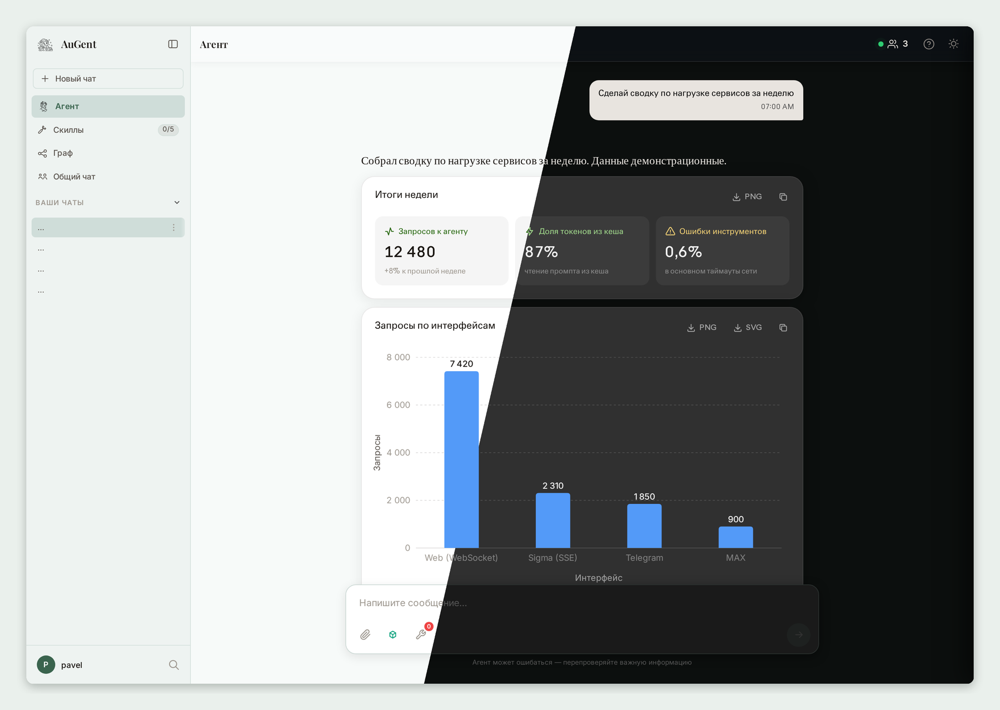
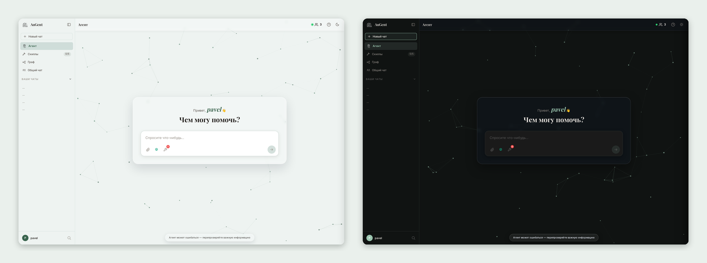
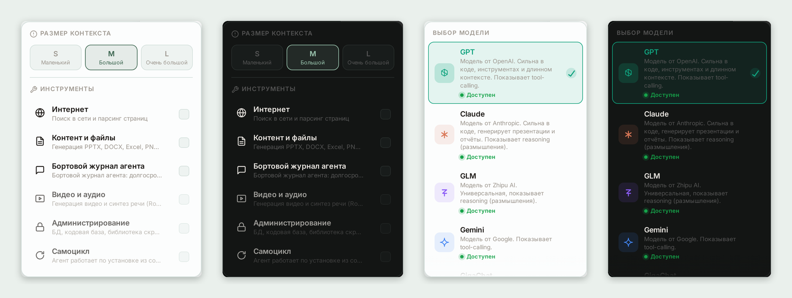
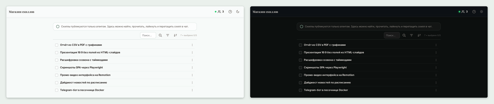
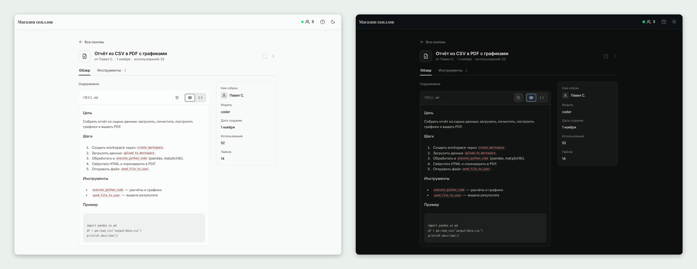
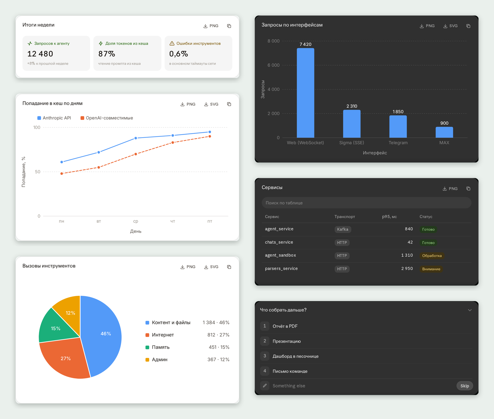
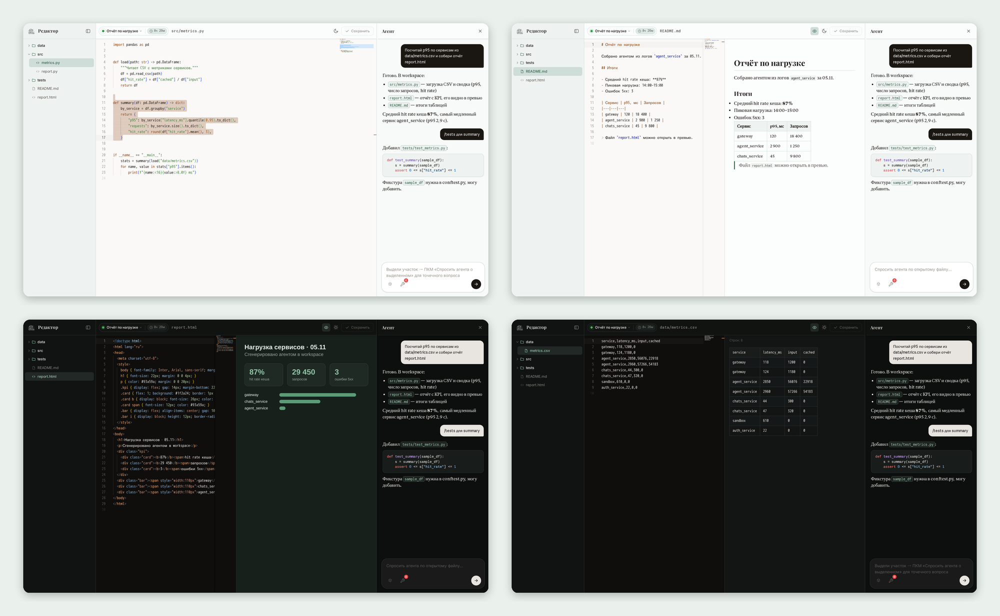
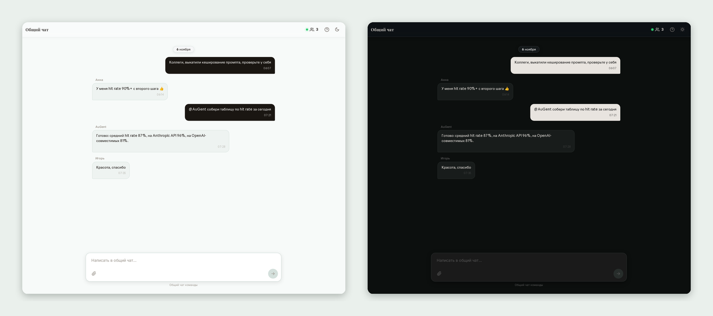
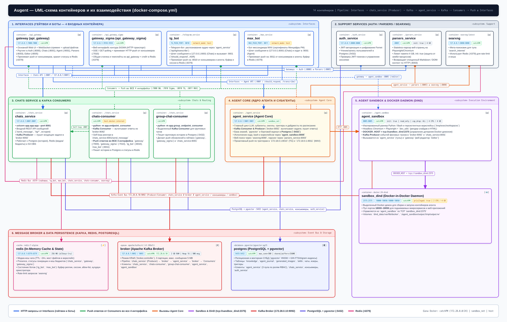

<div align="center">

# AuGent

**Универсальный AI-агент для рабочих задач: микросервисы, Kafka, Redis, изолированная песочница и четыре интерфейса.**




</div>

---

## Содержание
- [Что умеет](#что-умеет)
- [Интерфейс](#интерфейс)
- [Архитектура](#архитектура)
- [Сервисы](#сервисы)
- [Цикл агента и кеширование токенов](#цикл-агента-и-кеширование-токенов)
- [Инструменты и settings.py](#инструменты-и-settingspy)
- [Запуск](#запуск)
- [База данных](#база-данных)
- [Тесты](#тесты)

---

## Что умеет

- **Собственный цикл агента на LangChain.** Стриминг ответа, параллельные вызовы инструментов, повторы при сбоях, лимит шагов, фоновый супервизор и сжатие контекста.
- **Кеширование промпта.** Anthropic API получает метки cache_control, OpenAI-совместимые модели получают заголовки с ключом сессии чата. Со второго шага из кеша читается почти весь вход.
- **Песочница для кода.** Python, shell, Playwright с Chromium, ffmpeg, LibreOffice и Docker-in-Docker для временных сервисов.
- **Веб-редактор workspace.** Файлы, которые собирает агент, можно открыть и поправить прямо в браузере.
- **Четыре интерфейса.** Веб-чат через WebSocket, веб-чат через SSE, Telegram и MAX.
- **Генеративный UI.** Агент отвечает интерактивными графиками, KPI-карточками, таблицами и опросами.
- **Скиллы.** Библиотека повторно используемых инструкций, которые можно подключить к чату.
- **Общий чат.** Комната для команды, где агента зовут по упоминанию.
- **Выбор модели.** Список моделей задаётся в YAML, фронт подхватывает его автоматически.

---

## Интерфейс

### Светлая и тёмная тема
Акцентный цвет настраивается пользователем. На скриншотах взят #3A644E.



### Инструменты и выбор модели
Панель инструментов включает категории тулов и задаёт размер контекста. Панель моделей показывает доступность каждого провайдера.



### Скиллы
Скилл хранит цель, шаги, список инструментов и пример. Его можно отметить для чата, лайкнуть, отредактировать или экспортировать как промпт.





### Генеративный UI
JSON-блок в ответе агента превращается в компонент: MetricCards, Chart (bar, line, pie, scatter), DataTable или InteractivePoll.



### Веб-редактор /editor
Агент работает во временных workspace на фабрике (сервис agent_sandbox). Редактор /editor открывает workspace прямо в браузере, так что файлы, собранные агентом, можно поправить без скачивания.

- **Дерево файлов** слева. Сверху переключатель workspace и оставшийся срок жизни.
- **Monaco** в центре: подсветка синтаксиса, светлая и тёмная тема, сохранение по Ctrl+S. Если агент изменил открытый файл, редактор предложит перезагрузить его или оставить свою версию.
- **Превью** рядом с кодом (Shift+V): Markdown, HTML в изолированном iframe, CSV и TSV таблицей, изображения и SVG.
- **Агент** справа. Он видит открытый файл и выделенный фрагмент, есть быстрые команды /tests, /explain, /review и /summary. История общая с чатом, к которому привязан workspace.
- **Live-обновление.** Изменения агента приходят в дерево и в открытый файл через SSE.

Workspace временный и удаляется после 10 часов без активности, любое изменение файла продлевает срок. Чтобы закрепить workspace насовсем, достаточно положить в его корень файл-маркер .ws_hold, тогда вместо таймера будет значок закреплённой области. В Sigma редактор открывается только для чтения.



### Общий чат
Лента сообщений команды с закреплением, правкой и вложениями. Агент отвечает в ленте, когда его упоминают.



---

## Архитектура



Запрос пользователя проходит так:
1. Интерфейс (gateway, gateway_sigma, tg_bot или max_bot) передаёт сообщение в chats_service.
2. chats_service сохраняет сообщение и публикует задачу в Kafka.
3. agent_service читает задачу, выполняет цикл агента и вызывает инструменты, в том числе agent_sandbox.
4. Ответ возвращается через Kafka. chats-consumer сохраняет его и отправляет в тот интерфейс, откуда пришёл запрос.

Redis хранит статусы генерации, медиа из чатов (около 24 часов), состояние ботов и rate limit.

---

## Сервисы

| Сервис | Назначение |
|---|---|
| gateway | Основной веб-интерфейс: страницы, статика, WebSocket, JWT, прокси к остальным сервисам, редактор /editor |
| gateway_sigma | Второй веб-интерфейс с транспортом SSE; редактор открывается только для чтения |
| tg_bot | Telegram-бот: текст, голосовые с распознаванием речи, альбомы, проактивные сообщения |
| max_bot | Бот для мессенджера MAX |
| auth_service | Пользователи, выдача и проверка JWT |
| chats_service | REST API чатов и сообщений, продюсер задач в Kafka, бюджет самоцикла |
| chats-consumer | Читает ответы агента из Kafka и рассылает их в интерфейсы |
| group-chat-consumer | Обрабатывает сообщения общего чата и пишет историю в PostgreSQL |
| agent_service | Ядро агента: цикл LLM, инструменты, субагенты, скиллы, триггеры, учёт токенов |
| agent_sandbox | Изолированное исполнение кода и workspace (read-only, cap_drop ALL) |
| sandbox_dind | Отдельный Docker-демон для контейнеров, которые запускает агент |
| parsers_service | Парсинг веб-страниц через Playwright |
| searxng | Метапоиск для инструмента search_internet |
| broker | Kafka в режиме KRaft |
| redis | Кеш и шина статусов |
| postgres | PostgreSQL с pgvector: пользователи, чаты, скиллы, журнал агента, изображения |

Порты сервисов задаются в env.example, публикация на хост описана в docker-compose.yml.

---

## Цикл агента и кеширование токенов

Цикл агента написан вручную поверх моделей LangChain, без AgentExecutor. Код лежит в agent_service/app/agent/event_loop.py.

- Ответ модели стримится, независимые вызовы инструментов выполняются параллельно.
- При ошибках провайдера запрос повторяется, число шагов ограничено.
- Фоновый супервизор следит за ходом работы, компактор сжимает старую историю.
- Каждый шаг пишет в лог строку `[tokens]` с полями in, out, cached, cache_write и hit. Итог по запросу, включая расход каждого инструмента, сохраняется в chats.tokens_usage.

Кеширование включается флагом prompt_cache в models_config.yaml:
- **Anthropic API.** Метки cache_control ставятся на статический системный промпт, последний вопрос пользователя и два последних результата инструментов. На следующем шаге из кеша читается весь вход предыдущего шага.
- **OpenAI-совместимые модели.** Запрос получает заголовок X-Enable-Prompt-Cache и x-session-id с id чата. Балансировщик провайдера отправляет все шаги одного чата на одну реплику.

Модели описываются в agent_service/app/agent/core/models_config.yaml: провайдер, лимиты, параметры рассуждений, подпись, описание, цвет и иконка для фронта. Новая модель появляется в интерфейсе после добавления записи в этот файл.

---

## Инструменты и settings.py

Файл agent_service/app/agent/core/settings.py задаёт, какие инструменты агент получает в запросе.

**TOOLS_SETTINGS** — категории, которые пользователь включает в панели инструментов:

| Категория | Инструменты |
|---|---|
| internet | поиск в интернете, парсинг страниц |
| content | Python в песочнице, библиотека кода, генерация изображений, расшифровка аудио и видео, фоновые задачи, отправка файлов |
| sessions | бортовой журнал: память агента внутри чата |
| media_gen | генерация видео, речи и музыки (только админ, платные модели) |
| admin | SQL к базе, чтение и поиск по коду, shell |

**ADMIN_ONLY_CATEGORIES** — категории, которые видит только администратор.

**UNIVERSAL_TOOLS** — инструменты, доступные всегда: анализ изображений, скиллы, работа с workspace, отправка файлов и почты, триггеры по расписанию.

**TOOL_DESCRIPTIONS** — однострочные описания инструментов для супервизора. Он получает только те инструменты, которые доступны в текущем запросе.

Чтобы добавить инструмент: зарегистрировать его в agent_service/app/agent/tools, вписать имя в категорию или UNIVERSAL_TOOLS и добавить описание в TOOL_DESCRIPTIONS.

---

## Запуск

Нужен Docker с Compose v2. Образ песочницы agent_sandbox весит около 3,3 ГБ, остальные образы заметно меньше.

```bash
cp env.example .env
# заполнить .env: пароли БД, SECRET_KEY, FERNET_KEY, CLOUD_LLM_ACCESS_KEY, токены ботов
docker compose up -d --build
docker compose ps
```

Веб-интерфейс открывается на адресе gateway (порт PORT_GATEWAY_PORT). Боты стартуют, только если заданы их токены.

Полезные команды:

```bash
docker compose logs -f agent_service        # лог агента, в том числе строки [tokens]
docker compose up -d --build gateway        # пересобрать один сервис
docker compose down                         # остановить, данные в volume сохраняются
```

---

## База данных

Схема лежит в postgres/sql и разбита по разделам: 00_init, 01_auth, 02_chats, 03_agent, 04_knowledge, 05_grants. Образ postgres применяет её скриптом apply-schema.sh при каждом старте контейнера. Скрипты идемпотентны: на пустом томе создаются таблицы, роли и гранты, на существующей базе добавляется только недостающее. Подробности в postgres/README.md.

Таблицы не удаляются автоматически. Если таблица убрана из схемы, на старой базе она остаётся, пока её не удалить вручную.

**Импорт данных из другой базы:**

```bash
# выгрузка данных со старого сервера
pg_dump -h <old-host> -U <user> -d <db> --data-only --no-owner -Fc -f augent.dump

# загрузка в контейнер: схема уже создана, переносим только данные
docker compose cp augent.dump postgres:/tmp/augent.dump
docker compose exec postgres sh -c 'pg_restore -U "$POSTGRES_USER" -d "$POSTGRES_DB" --data-only --no-owner --disable-triggers /tmp/augent.dump'
```

Для SQL-дампа в текстовом формате:

```bash
docker compose exec -T postgres sh -c 'psql -U "$POSTGRES_USER" -d "$POSTGRES_DB"' < dump.sql
```

Чтобы применить схему повторно после правки SQL-файлов, достаточно перезапустить контейнер: `docker compose restart postgres`.

---

## Тесты

Каждый сервис тестируется в собственном образе: стадия test в Dockerfile, сборка через docker-compose.test.yml. Сеть и внешние сервисы тестам не нужны.

```bash
./run_tests.sh                                  # все сервисы
./run_tests.sh agent_service api_gateway        # выбранные
PYTEST_ARGS="-x -k editor" ./run_tests.sh api_gateway   # аргументы pytest
```

Логи пишутся в .test-logs/<сервис>.log, в конце выводится сводка по сервисам. Скрипт возвращает 0, если все сервисы зелёные.

Сервисы с тестами: agent_sandbox, agent_service, api_gateway, api_gateway_sigma, auth_service, chats_service, max_service, parsers_service, telegram_service.
