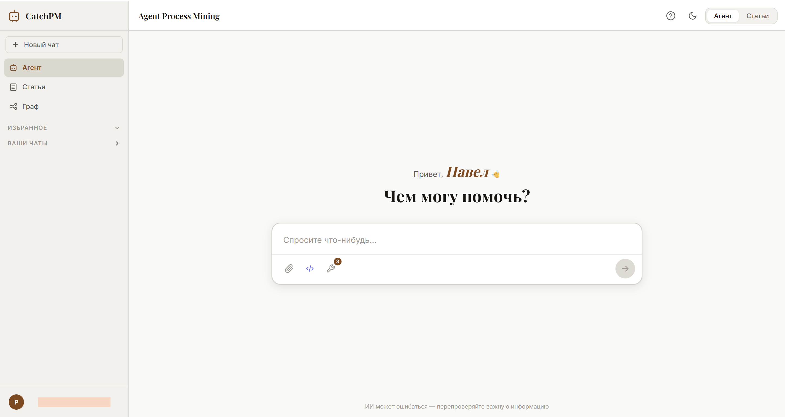
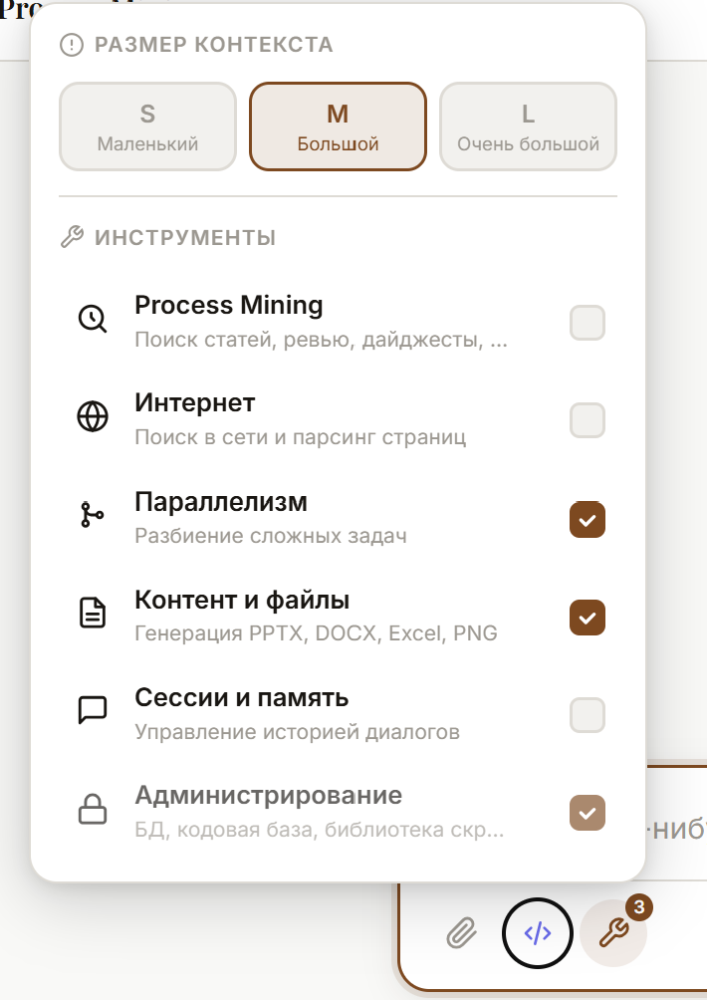

# Microservices — платформа CatchPM

Монорепозиторий микросервисной платформы, на которой живёт AI-агент по управлению базой знаний Process Mining (**PMыч / CatchPM**). Платформа объединяет оркестрацию задач, LLM-агента с расширяемым тулсетом, изолированную среду исполнения кода («Фабрику»), парсинг научных статей, работу с чатами в реальном времени и единый API Gateway.

Репозиторий: `pascha_groznyj/Microservices`
Ветка по умолчанию: `main`

---

## Интерфейс платформы

### Главная страница


### Динамические инструменты агента


---

## Что это такое

Платформа — это набор независимых сервисов, связанных через Kafka и HTTP за единым API Gateway. В центре — `agent_service`: LangChain-агент на OpenAI-совместимых моделях, который умеет искать по векторной базе знаний (FAISS), работать с PostgreSQL и объектным хранилищем (OBS SberCloud), парсить веб-страницы, генерировать документы и презентации, отправлять почту и исполнять произвольный код в изолированной песочнице.

Основные сценарии:

- Поиск статей по Process Mining, сборка ревью и дайджестов.
- Ведение базы знаний: добавление, обновление, семантический поиск.
- Автоматический парсинг научных статей из arXiv, IEEE, Google Scholar.
- Исполнение задач в «Фабрике» — изолированной sandbox-среде с браузером, генерацией графиков, PDF и презентаций.
- Делегирование подзадач субагентам (data_analyst, scraper, researcher, content_maker и др.).
- Доставка результатов пользователю в чат, Telegram и на почту.

---

## Архитектура

```
                       ┌────────────────────┐
                       │    api_gateway      │  :7000
                       │  единая точка входа │
                       │  JWT · CORS · static│
                       └─────────┬──────────┘
             ┌───────────────────┼───────────────────┐
             │                   │                   │
      ┌──────▼──────┐    ┌───────▼───────┐    ┌──────▼───────┐
      │ auth_service│    │ chats_service │    │agent_service │
      │    :8000    │    │    :8001      │    │    :9001     │
      │ JWT · users │    │ WebSocket·KFK │    │ LLM · tools  │
      └─────────────┘    └───────────────┘    └──────┬───────┘
                                                     │
                          ┌──────────────────────────┼──────────────────┐
                          │                          │                  │
                   ┌──────▼───────┐          ┌───────▼────────┐  ┌──────▼──────┐
                   │parsers_service│          │ agent_sandbox  │  │ PostgreSQL  │
                   │    :8003      │          │  (Фабрика)     │  │    OBS      │
                   │ arXiv·IEEE·GS │          │ code · browser │  │   Kafka     │
                   └───────────────┘          └────────────────┘  └─────────────┘
```

Связи между сервисами:

- Синхронно — HTTP через `api_gateway`.
- Асинхронно — события через Kafka (новые сообщения, завершение задач Фабрики, авто-триггеры консьюмеров).
- Данные — PostgreSQL (знания, метаданные, чаты, журнал агента) и OBS SberCloud (файлы, PDF, артефакты).

---

## Сервисы

### api_gateway — `:7000`
Единая точка входа монорепозитория. JWT-аутентификация, CORS, раздача статики, проксирование на upstream-сервисы.
- Стек: FastAPI, Uvicorn, httpx AsyncClient, python-jose, Jinja2, CORSMiddleware.
- Upstream: `auth_service`, `chats_service`, `parsers_service`, `agent_service`.

### auth_service — `:8000`
Аутентификация и авторизация. Выдаёт JWT-токены, управляет пользователями, обеспечивает межсервисную авторизацию.
- Стек: FastAPI, python-jose[cryptography], bcrypt, asyncpg, httpx.
- Ключевые env: `DATABASE_URL`, `SECRET_KEY`, `ALGORITHM`, `ACCESS_TOKEN_EXPIRE_MINUTES`, `ADMIN_USERNAMES`.

### chats_service — `:8001`
Управление чатами и обмен сообщениями в реальном времени через WebSocket. Producer/consumer Kafka.
- Стек: FastAPI, websockets + wsproto, asyncpg, kafka-python, python-jose, passlib[bcrypt].
- Публикует события о новых сообщениях, подписан на события смежных сервисов.

### parsers_service — `:8003`
Автоматический парсинг научных статей из открытых источников. Извлекает метаданные и PDF, сохраняет в PostgreSQL и OBS.
- Стек: FastAPI, Playwright + Chromium, PyMuPDF / PyPDF2 / WeasyPrint, BeautifulSoup4 + lxml, asyncpg, boto3 / aiobotocore, APScheduler.
- Источники: arXiv (официальный SDK), IEEE Xplore (HTTP scraping), Google Scholar (Playwright + Chromium).

### agent_service — `:9001`
Ядро платформы — AI-агент. Принимает задачи через Kafka и HTTP, исполняет их LangChain-агентами на OpenAI-совместимых моделях, ходит в PostgreSQL, OBS и внешние инструменты через расширяемый тулсет.
- Стек: FastAPI, websockets, LangChain 0.3.27, langchain_openai, FAISS-cpu, aiokafka, asyncpg, APScheduler, watchdog, aiobotocore / botocore, PyPDF2, python-docx, beautifulsoup4.
- Подсистемы: субагенты, тулзы, LangChain-цепочки, Kafka consumer/producer, FAISS-индексы, планировщик, watchdog-наблюдатели, работа с OBS.

### agent_sandbox — Фабрика
Изолированная sandbox-среда для безопасного исполнения Python-кода агентом. HTTP API для запуска скриптов, управления workspace и асинхронной очередью задач.
- Стек: Python 3.10-slim, uv, FastAPI + Uvicorn, Playwright 1.58.0 + Chromium, @playwright/mcp, matplotlib, pandas, numpy, reportlab, python-pptx, Pillow, Node.js/npm.
- Возможности: синхронное и асинхронное исполнение кода, персистентные workspace (TTL 1 час), генерация PNG/PDF/PPTX, headless-браузер для JS-SPA и CDP.
- Пользователь контейнера: `sandboxrunner` (uid 1500), запись только в `/app/workspace`, `/app/output`, `/tmp`.

---

## Тулсет агента

Агент работает через расширяемый набор инструментов. Основные группы:

- **База знаний**: семантический поиск, ревью, дайджесты, управление таблицей knowledge, переклассификация категорий.
- **Фабрика (sandbox)**: исполнение Python-кода, shell-команды, persistent workspaces, submit_task (асинхронные задачи с уведомлением через Kafka), переброс и точечное редактирование файлов в удалённой Фабрике.
- **Файлы и код-база проекта**: tree, grep, find, чтение файлов, черновики в `/sandbox`.
- **Библиотека кода** (`code_library`): поиск переиспользуемых скриптов, запуск, документирование.
- **Git**: работа с удалёнными репозиториями через MCP (GitVerse) и subprocess (GitHub).
- **Коммуникации**: почта (IMAP/SMTP через mailcow), отправка дайджестов и файлов пользователю.
- **Субагенты**: делегирование подзадач изолированным LLM-циклам с ограниченным тулсетом.
- **Бортовой журнал** (`agent_journal`): самоописание агента, предпочтения пользователей, аномалии, точки роста.

---

## Хронология развития (по коммитам)

История показывает, как платформа эволюционировала от базового набора сервисов к полноценной агентной инфраструктуре.

**Август 2026 — крупное обновление агентной инфраструктуры (`biG_update_agent`)**
- Разделение моделей на кодера, дизайнера и «llm для души», управление из gateway.
- Внутренний Docker-демон для сборки Docker-in-Docker.
- Эндпоинты переброса файлов из локальной песочницы агента в Фабрику и точечного редактирования файлов.
- Обновлённая инструкция работы агента с удалёнными репозиториями и поднятием Docker-образов.
- Поддержка shell-команд, авто-триггер консьюмер, доработка субагента.

**Август 2026 — документация сервисов**
- Добавлены README для `agent_sandbox`, `agent_service`, `auth_service`, `parsers_service`, `chats_service`, `api_gateway`.

**Август 2026 — Фабрика и коммуникации**
- Удалённая среда исполнения переведена в режим «НЕЖДУН ФАБРИКА»: задача исполняется, о завершении сообщается в Kafka.
- Подключение к почтовому ящику, MCP-взаимодействие с GitVerse.
- Универсальный парсер HTML-страниц с очисткой от лишнего, отдельный эндпоинт для агента.
- Настройка удалённой песочницы агента (Фабрика).
- Логика субагентов: действия подсвечиваются до основного ответа агента-оркестратора.
- Сервис Telegram больше не ждёт ответ от агента (нет timeout) — агент сам отправляет сообщение о готовности.

**Август 2026 — инфраструктура тулзов**
- Крупный пересбор инфраструктуры инструментов агента.
- Дефолтные команды tree/grep для работы агента с файлами проекта.

**Июль 2026 — данные и чаты**
- Новая таблица для отслеживания чатов пользователей: названия, флаг удаления, избранность.
- Переход на `uv` как менеджер пакетов.

---

## База данных

SQL-схемы лежат в `agent_service/app/agent_pm/core/sql_scripts/`:

- `agent_journal.sql` / `audit_agent_journal.sql` — бортовой журнал агента и его аудит.
- `knowledge.sql` — база знаний.
- `papers_tables.sql` — метаданные статей и ревью.
- `code_documentation.sql` — библиотека переиспользуемого кода.
- `logging_tokens.sql` — учёт токенов.

---

## Запуск

Каждый сервис собирается и запускается независимо через Docker, либо всё вместе через docker-compose.

```
# отдельный сервис
docker build -t agent_service ./agent_service
docker run -d --env-file .env -p 9001:9001 agent_service

# весь монорепозиторий
docker compose up
```

Порты сервисов:

| Сервис           | Порт |
|------------------|------|
| api_gateway      | 7000 |
| auth_service     | 8000 |
| chats_service    | 8001 |
| parsers_service  | 8003 |
| agent_service    | 9001 |
| agent_sandbox    | 8005 |

---

## Примечание

Подробное описание стека, структуры директорий, переменных окружения и API каждого сервиса находится в README внутри соответствующей директории:
`agent_service/README.md`, `agent_sandbox/README.md`, `parsers_service/README.md`, `chats_service/README.md`, `auth_service/README.md`, `api_gateway/README.md`.